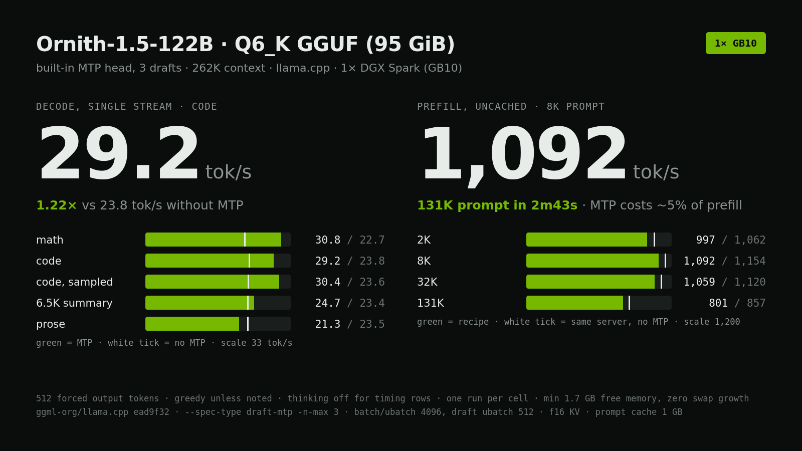

# Ornith-1.5-122B on one DGX Spark

The fastest single-GB10 recipe we measured for Ornith-1.5-122B at its largest quant that fits (Q6_K GGUF, 95 GiB): llama.cpp, the checkpoint's own MTP head with 3 draft tokens, 4096 ubatch, full 262K context.



## Result

| Config | Code | Math | Code, sampled | 6.5K summary | Prose | Prefill 2K | Prefill 8K | Prefill 32K | Prefill 131K |
|---|---:|---:|---:|---:|---:|---:|---:|---:|---:|
| **MTP 3, ubatch 4096 (this recipe)** | **29.2** | **30.8** | **30.4** | **24.7** | **21.3** | **997** | **1,092** | **1,059** | **801** |
| No MTP, ubatch 4096 | 23.8 | 22.7 | 23.6 | 23.4 | 23.5 | 1,062 | 1,154 | 1,120 | 857 |
| No MTP, ubatch 2048 (llama.cpp default batch geometry) | 20.6 | 20.9 | 20.8 | 20.8 | 21.0 | 365 | 660 | 905 | 727 |

All values tok/s, single stream, 262K context. Decode rows: 512 forced output tokens, greedy except `code, sampled` (temperature 0.6, top-p 0.95, top-k 20), thinking off. Prefill rows: uncached, a unique nonce at the start of each prompt. One run per cell.

A 131K-token prompt reaches first token in 2 min 43 s with the recipe.

**MTP draft depth** (ubatch 2048, draft ubatch = ubatch, mean of code/prose/math/summary):

| Drafts | Decode mean | Code | Prose | Draft acceptance, code / prose |
|---:|---:|---:|---:|---:|
| 1 | 27.7 | 29.3 | 24.6 | 0.89 / 0.61 |
| 2 | 27.4 | 31.1 | 24.5 | 0.77 / 0.48 |
| 3 | 28.1 | 30.9 | 21.2 | 0.68 / 0.36 |
| 4 | 25.6 | 27.5 | 19.2 | 0.56 / 0.31 |
| none | 20.8 | 20.6 | 21.0 | |

**Memory.** Minimum free memory during the recipe run was 1.7 GB, with zero swap growth. It fits, but with very little room left on a 128 GB box.

## Run it

Requirements: one GB10 (128 GB unified memory), CUDA 13, llama.cpp with Qwen3.5-MoE MTP support. We used `ead9f32`.

```bash
git clone https://github.com/ggml-org/llama.cpp ~/src/llama.cpp
cd ~/src/llama.cpp && git checkout ead9f3205848f81ca079b4e760b76a01a6359f4b
cmake -B build -DGGML_CUDA=ON -DGGML_NATIVE=ON -DCMAKE_CUDA_ARCHITECTURES=121a-real \
  -DCMAKE_BUILD_TYPE=Release -DLLAMA_BUILD_UI=OFF
cmake --build build -j --target llama-server

hf download ornith-ai/Ornith-1.5-122B-GGUF Ornith-1.5-122B-Q6_K.gguf \
  --revision 5514dc9eb187cb71eb3b1089716fbe1bdd7e7a7d \
  --local-dir ~/models/Ornith-1.5-122B-GGUF

LLAMA=~/src/llama.cpp ./serve.sh
```

The server listens on `127.0.0.1:8002`. Loading reads 95 GiB from disk (about 90 s on our NVMe).

```bash
curl -s http://127.0.0.1:8002/v1/chat/completions -H 'Content-Type: application/json' -d '{
  "messages": [{"role": "user", "content": "What is 17*23? Answer with just the number."}],
  "max_tokens": 2048}'
```

Reasoning is on by default and returned in `reasoning_content`. Send `"chat_template_kwargs": {"enable_thinking": false}` to turn it off. Reasoning and answer share `max_tokens`. The model card recommends temperature 0.6, top-p 0.95, top-k 20 for coding.

## What we changed from defaults, and why

- **`--spec-type draft-mtp --spec-draft-n-max 3`.** The GGUF ships the MTP layer (`blk.48.nextn.*`), so no separate drafter is needed. 3 drafts had the best mean; 1 and 2 are close and better on prose.
- **`-b 4096 -ub 4096`.** Prefill goes from 365 to about 1,060 tok/s at 2K and from 660 to about 1,150 at 8K compared to ubatch 2048. Decode also moved up slightly without MTP (20.8 to 23.4 mean). ubatch 1024 was slower (912 at 8K).
- **`--spec-draft-n-ubatch 512`.** MTP plus ubatch 4096 ran out of memory at load until the draft context's batch was cut to 512.
- **`-cram 1024 -ctxcp 8`.** The default 8 GB host prompt cache got the MTP server killed by our memory watchdog mid-benchmark. 1 GB keeps it in budget.
- **`--load-mode none`.** Loads weights into memory instead of mmap, so page cache and model weights don't double-count.

Tried and dropped:

- **q8_0 KV cache with MTP + ubatch 4096**: server died during the decode panel (out of memory).
- **ubatch 3072 with MTP**: same.
- **4 drafts with `--spec-draft-p-min 0.6`, ubatch 4096**: failed to load inside our 1 GB free-memory floor (before the draft-ubatch fix, not retried).
- **131K context instead of 262K**: no speed gain worth losing half the window (26.7 mean decode, prefill within 5%).

## Limits

- **Prose barely benefits.** MTP accepts only 36% of drafts on free-form prose at depth 3, which lands at 21.3 tok/s against 23.5 without MTP. Code and math gain 22 to 36%. If your workload is mostly prose, run with `--spec-draft-n-max 1` or without MTP.
- **MTP costs about 5% prefill**, because the draft head also processes the prompt.
- **One run per cell.** Treat differences under about 3% as noise.
- **No quality evaluation.** This is a speed recipe for the publisher's Q6_K artifact. Smokes passed (exact arithmetic with thinking on), but outputs with and without MTP were not checked for identity.
- **Tight memory.** 1.7 GB minimum free at 262K context. Don't run anything else heavy on the box.
- **TensorFold was not usable.** Its CUDA path for this model family reads MLX 4-bit checkpoints only, not GGUF. No DFlash/DSpark drafter exists for the 122B.

## Method

`bench/bench.py` launches one server per arm under `systemd-run`, waits for `/health`, runs an exact-answer smoke, then the decode panel and the prefill ladder, and stops the server. A watchdog kills the server if free memory drops under 1-1.5 GB or swap grows more than 6 GB. Speeds come from llama-server's per-request `timings` (`predicted_per_second`, `prompt_per_second`, `draft_n`, `draft_n_accepted`). `bench/analyze.py` prints the per-arm table. Raw per-arm results, including failed arms, are in `results.json`.

## Pinned versions

- Model: `ornith-ai/Ornith-1.5-122B-GGUF` @ `5514dc9eb187cb71eb3b1089716fbe1bdd7e7a7d`, `Ornith-1.5-122B-Q6_K.gguf`, 102,380,498,912 bytes, SHA-256 `93335cdb8ddf658ad1891a41b13e7b0d91c4590e1a9a3d5b8d4f2fce1eff1f5c`
- Runtime: `ggml-org/llama.cpp` @ `ead9f3205848f81ca079b4e760b76a01a6359f4b`, CUDA 13.0.88, driver 580.159.03, `CMAKE_CUDA_ARCHITECTURES=121a-real`
- Hardware: 1× NVIDIA DGX Spark (GB10, 128 GB unified memory)
